<div align="center">

# ⚡🚗 Veriden Tahmine: EV Araç Tercih Analizi

**Bir kişinin yaşı, geliri, günlük yolu ve şarj imkânlarına bakarak<br>elektrikli araç (EV) alıp almayacağını tahmin eden uçtan uca bir yapay zekâ projesi.**

<br>

[](https://colab.research.google.com/github/busrasagdic/software-persona-veriden-tahmine/blob/main/proje1-veriden-tahmine.ipynb)


</div>

---

## 📊 Bir Bakışta Sonuçlar

<div align="center">

| 👥 Veri | 🎯 Test doğruluğu | 🔍 Recall (EV alanlar) | 🧠 Ezber farkı | 🏆 En güçlü etken |
|:---:|:---:|:---:|:---:|:---:|
| **10.000** kişi | **%79,0** | **%86,6** | **0,0** puan | **Devlet teşviki** |

</div>

> 💡 **Ana bulgu:** Teşvik varsa EV alma oranı **%27,4**, yoksa sadece **%2,5**. Teşvik oranı yaklaşık **11 kat** artırıyor.

---

## 🗺️ Proje Akışı

Proje, *Proje Envanteri*'ndeki **7 aşamayı** sırayla izler:

```mermaid
flowchart LR
    A["1️⃣ Problem<br>Tanımı"] --> B["2️⃣ Veri Toplama<br>& Temizleme"]
    B --> C["3️⃣ Keşifçi<br>Analiz (EDA)"]
    C --> D["4️⃣ Model<br>Kurma"]
    D --> E["5️⃣ Tahmin &<br>Değerlendirme"]
    E --> F["6️⃣ Akıllı Tahmin<br>Aracı"]
    F --> G["7️⃣ Doküman-<br>tasyon"]

    style A fill:#e9f5f3,stroke:#2a9d8f,color:#1d3b36
    style B fill:#e9f5f3,stroke:#2a9d8f,color:#1d3b36
    style C fill:#e9f5f3,stroke:#2a9d8f,color:#1d3b36
    style D fill:#2a9d8f,stroke:#1f7a6f,color:#ffffff
    style E fill:#2a9d8f,stroke:#1f7a6f,color:#ffffff
    style F fill:#264653,stroke:#1b323b,color:#ffffff
    style G fill:#264653,stroke:#1b323b,color:#ffffff
```

| Aşama | Konu | Çıktı |
|:---:|---|---|
| 1 | Problem tanımı | Proje Tanım Formu + gerekçe |
| 2 | Veri toplama ve hazırlama | CSV, veri sözlüğü, eksik değer temizliği |
| 3 | Keşifçi veri analizi (EDA) | Özet tablolar, 4 grafik, keşif bulguları |
| 4 | Model kurma ve eğitme | Karar ağacı, %80 / %20 eğitim-test bölünmesi |
| 5 | Tahmin ve değerlendirme | Doğruluk, precision/recall, confusion matrix |
| 6 | Akıllı tahmin aracı | `tahmin_et()` + `input()` uygulaması + araç önerisi |
| 7 | Dokümantasyon | Sonuç özeti, sınırlamalar, kaynakça |

---

## 🎯 Problem

| | |
|---|---|
| **Alan** | Ulaşım / otomotiv |
| **Soru** | Bu kişi elektrikli araç alır mı? |
| **Hedef (y)** | `Will_Buy_EV` → `Yes` / `No` |
| **Problem türü** | **Sınıflandırma** |
| **Model** | Karar Ağacı (`DecisionTreeClassifier`) |

**Kimin işine yarar?** Otomobil bayileri (doğru müşteriye kampanya), belediyeler ve şarj şirketleri (istasyon yeri), kamu kurumları (teşvik etkisi) ve tüketiciler (EV bana uygun mu?).

---

## 🗂️ Veri Setleri

| | Ana veri (tercih) | Ek veri (araç özellikleri) |
|---|---|---|
| **Kaynak** | [Kaggle · EV Adoption Behavior and Range Anxiety](https://www.kaggle.com/datasets/itzzomkar/ev-adoption-behavior-and-range-anxiety) | [Hugging Face · Electric Vehicle Specs 2025](https://huggingface.co/datasets/UrvishAhir1/Electric-Vehicle-Specs-Dataset-2025) |
| **Boyut** | 10.000 kişi × 15 sütun | 478 araç × 22 sütun |
| **Lisans** | CC0 | CC BY 4.0 |
| **Gerçek mi?** | ⚠️ Sentetik | ✅ Gerçek (ev-database.org) |

**Temizlik:** 3 sayısal sütunda toplam **543 eksik hücre** (%0,36) vardı, hepsi **ortanca (median)** ile dolduruldu. Tekrarlanan satır yok.

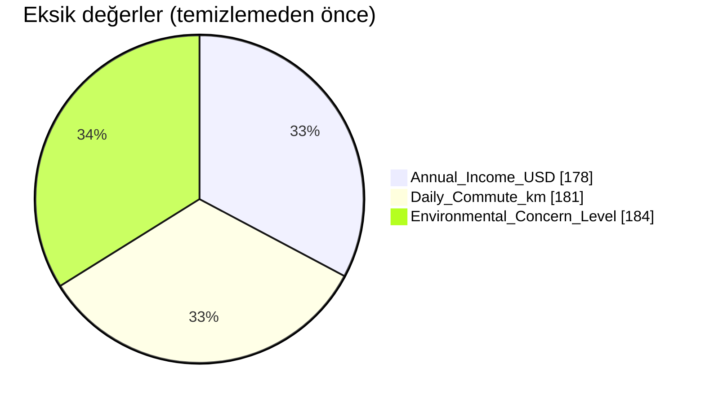

---

## 🔎 Keşifçi Veri Analizi

### Sınıflar dengesiz

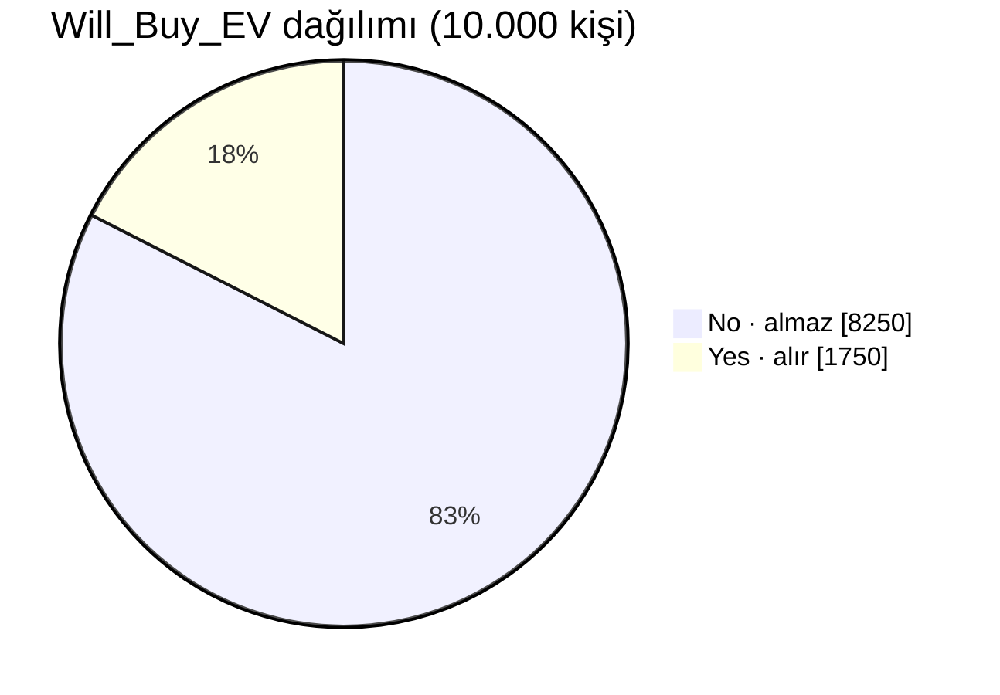

Sadece **%17,5** EV alıyor. Bu yüzden doğruluk tek başına yanıltıcı olur; recall ve precision'a da bakıyoruz.

### Çevre duyarlılığı arttıkça EV alma oranı tırmanıyor

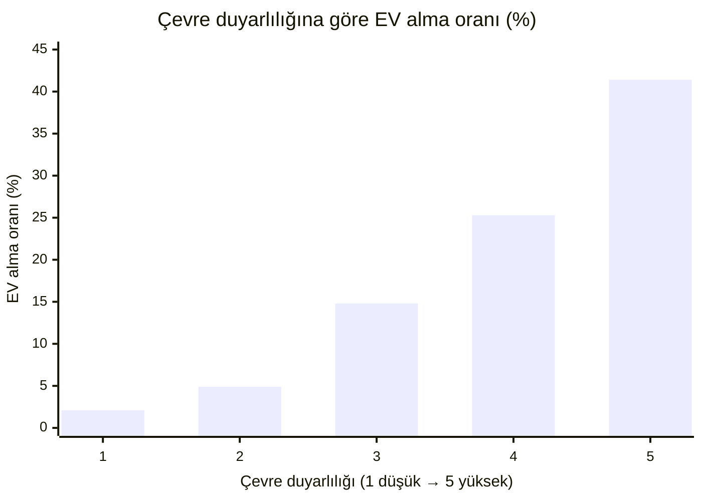

### Grafikler

<table>
<tr>
<td width="50%" align="center">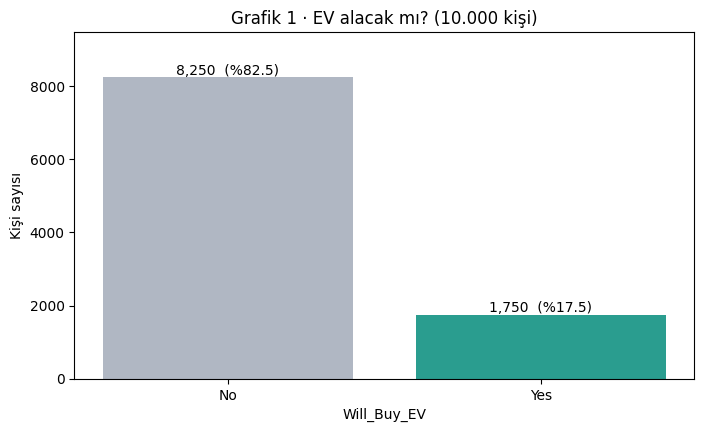<br><sub><b>Grafik 1</b> · EV alacak mı? 8.250 No / 1.750 Yes</sub></td>
<td width="50%" align="center">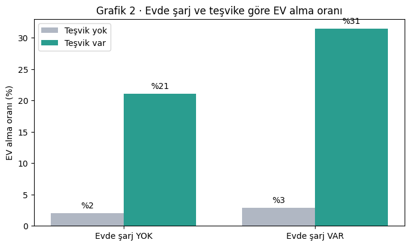<br><sub><b>Grafik 2</b> · Teşvik yoksa evde şarj olsa bile oran %3'ün altında</sub></td>
</tr>
<tr>
<td width="50%" align="center">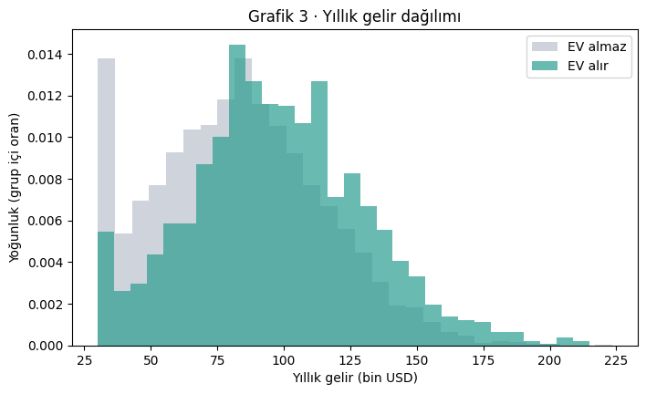<br><sub><b>Grafik 3</b> · EV alanların geliri daha yüksek (97,6K vs 82,8K USD)</sub></td>
<td width="50%" align="center">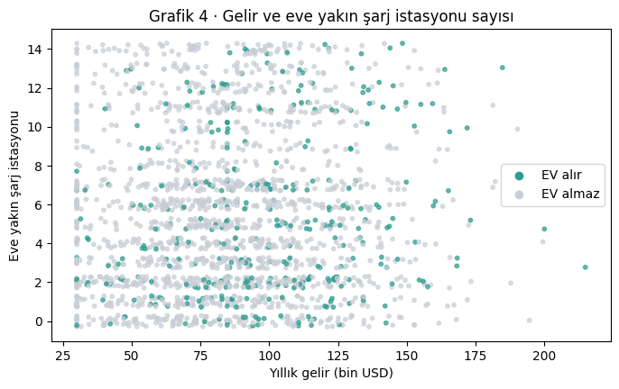<br><sub><b>Grafik 4</b> · Gelir × eve yakın şarj istasyonu (2.000 kişi)</sub></td>
</tr>
</table>

### 📌 Keşif bulguları

| # | Bulgu | Rakam |
|:---:|---|---|
| 1 | **Devlet teşviki en güçlü etken** | Var: **%27,4** · Yok: **%2,5** |
| 2 | **Çevre duyarlılığı düzenli artış sağlıyor** | Seviye 1: %2,1 → Seviye 5: **%41,4** |
| 3 | **Yüksek gelir → daha çok EV** | Alanlar ~97.600 USD · Almayanlar ~82.800 USD |
| 4 | **Evde şarj tek başına sınırlı** | Var: %20,1 · Yok: %13,4 |
| 5 | **Etkisiz özellikler** | Yaş, günlük yol, şehir tipi, araç tipi, cinsiyet |

---

## 🌳 Model

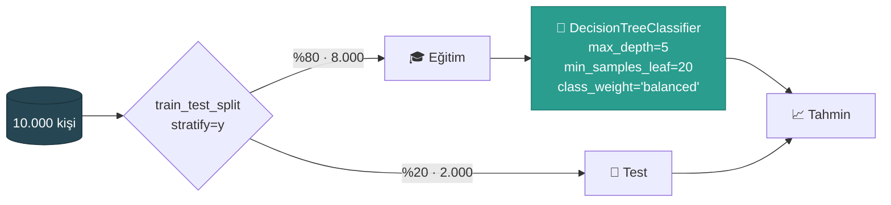

- **12 özellik** → one-hot encoding sonrası **16 sütun**
- `Range_Anxiety_Level` bilerek **kullanılmadı**: kişinin karar anındaki duygusu, önceden bilinemez.
- Ağaç: **5 seviye**, **31 yaprak**

<div align="center">
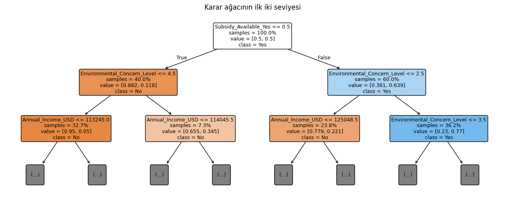<br>
<sub>Karar ağacının ilk iki seviyesi: ilk soru <b>teşvik var mı?</b></sub>
</div>

---

## 📈 Değerlendirme

### Model vs. temel çizgi

| Model | Doğruluk | Recall (Yes) | Precision (Yes) | F1 (Yes) |
|---|:---:|:---:|:---:|:---:|
| Hep "No" diyen (baseline) | %82,5 | **0,000** ❌ | – | – |
| **Karar ağacı** | %79,0 | **0,866** ✅ | 0,449 | 0,591 |

> 🧭 Doğruluk temel çizginin biraz altında, ama bu **bilinçli bir tercih**: `class_weight='balanced'` modele *"EV alacak kişiyi kaçırma"* dedi. Hep "No" diyen model hiçbir EV alıcısını bulamıyor; bizim model **350 alıcının 303'ünü** buluyor.

<table>
<tr>
<td width="50%" align="center">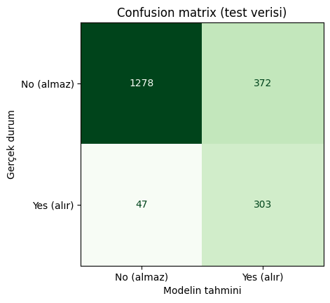<br><sub><b>Confusion matrix</b> · TN 1278 · FP 372 · FN 47 · TP 303</sub></td>
<td width="50%" align="center">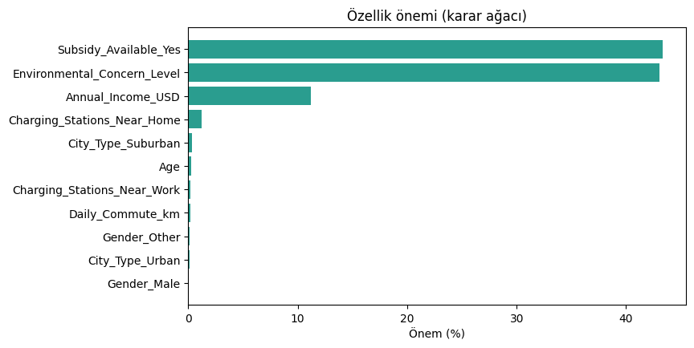<br><sub><b>Özellik önemi</b> · Teşvik ve çevre duyarlılığı kararların %86'sı</sub></td>
</tr>
</table>

### Özellik önemi

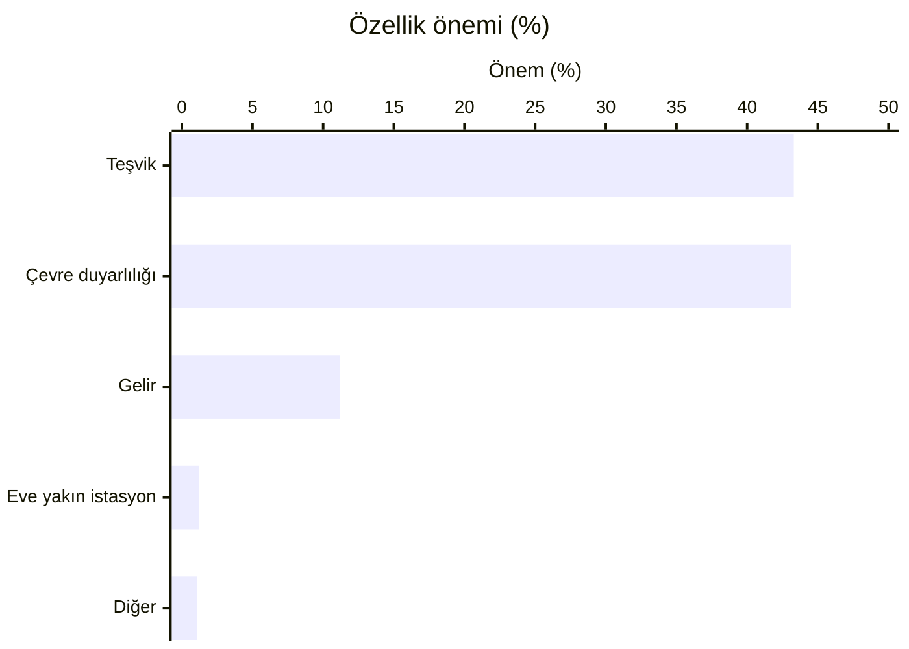

### Aşırı öğrenme kontrolü

| Model | Eğitim | Test | Derinlik | Yorum |
|---|:---:|:---:|:---:|---|
| **Bizim model** | %79,1 | %79,0 | 5 | ✅ Ezber yok |
| Sınırsız ağaç | %100,0 | %81,0 | 26 | ⚠️ Ezberliyor |

---

## 🤖 Akıllı Tahmin Aracı

`tahmin_et()` fonksiyonu kişinin bilgilerini alır, EV alma olasılığını ve bir yorum döndürür:

| Olasılık | Yorum |
|:---:|---|
| **≥ %65** | ✅ EV almaya **yüksek** ihtimalle yatkın |
| **%40 – %65** | 🤔 **Kararsız**; teşvik veya şarj kararı değiştirebilir |
| **< %40** | ❌ EV alma ihtimali **düşük** |

**Örnek kişiler:**

| Kişi | Profil | Tahmin | Olasılık |
|:---:|---|:---:|:---:|
| A | 32 yaş, şehir, 85K USD, evde şarj ✔, teşvik ✔, çevre 5 | ✅ Yes | **%92** |
| B | 55 yaş, kırsal, 40K USD, evde şarj ✘, teşvik ✘, çevre 2 | ❌ No | %1 |
| C | 41 yaş, banliyö, 60K USD, evde şarj ✔, teşvik ✘, çevre 3 | ❌ No | %1 |

Uygulama Türkçe sorular sorar (`e/h`, `m/b/k`), aylık TL geliri yıllık USD'ye çevirir ve yanlış girişte tekrar sorar:

```text
=== EV Tercih Tahmin Aracı ===
Yaşın (25-70): 30
Aylık gelirin (TL): 300000
Evde şarj edebilir misin? (e/h): e
Çevre duyarlılığın (1-5): 5
Devlet teşviki var mı? (e/h): e
...
Verdiğin bilgilere göre elektrikli araç alma olasılığın %44.
KARARSIZ görünüyor; teşvik veya şarj imkânı kararı değiştirebilir. 🤔
```

### 🔋 Bonus: Sana uygun gerçek EV'ler

478 gerçek EV modeli arasından, günlük yola ve evde şarj imkânına göre yeterli menzili olan **en verimli** araçlar önerilir.

<table>
<tr>
<td width="55%">

**Günde 40 km, evde şarj var → en az 250 km menzil**

| Marka | Model | Menzil | Wh/km |
|---|---|:---:|:---:|
| Tesla | Model 3 RWD (LFP64) | 445 km | 116 |
| Tesla | Model 3 LR RWD | 545 km | 117 |
| Hyundai | IONIQ 6 SR 2WD | 335 km | 117 |
| Tesla | Model 3 LR AWD | 525 km | 119 |
| Citroën | e-C4 X 54 kWh | 335 km | 119 |

</td>
<td width="45%" align="center">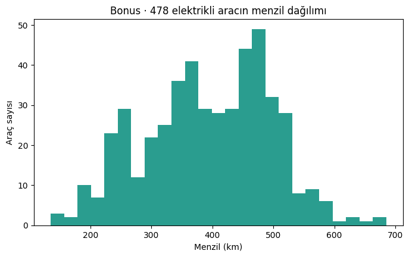<br><sub>478 EV'nin menzil dağılımı (135 – 685 km, ortanca 398 km)</sub></td>
</tr>
</table>

---

## 🚀 Nasıl Çalıştırılır?

1. Yukarıdaki **Open in Colab** rozetine tıkla.
2. **Çalışma zamanı → Tümünü çalıştır** (Runtime → Run all).
3. Veri setleri otomatik indirilir (`kagglehub` → `curl` → elle yükleme sırasıyla denenir).
4. Aşama 6'daki hücrede soruları cevapla ve kendi tahminini gör.

Yerelde çalıştırmak için:

```bash
pip install pandas numpy matplotlib scikit-learn kagglehub jupyter
```

```bash
jupyter notebook proje1-veriden-tahmine.ipynb
```

---

## 📁 Proje Dosyaları

```text
📦 software-persona-veriden-tahmine
 ┣ 📓 proje1-veriden-tahmine.ipynb                         → Tüm kod, analiz ve grafikler
 ┣ 📄 proje1- veriden-tahmine-ev-araç-tercih-proje-analizi_1.docx  → Proje analizi
 ┣ 📄 proje1- veriden-tahmine-ev-araç-tercih-proje-raporu_1.docx   → Proje raporu
 ┣ 📊 proje1- veriden-tahmine-ev-araç-tercih-proje-sunum_1.pptx    → Sunum
 ┣ 🖼️ images/                                              → README grafikleri
 ┗ 📘 README.md
```

---

## ⚠️ Sınırlamalar

1. **Veri sentetik.** Yöntemi öğrenmek için ideal, ama gerçek tüketici davranışını kanıtlamaz.
2. **Türkiye'ye genellenemez.** Gelir USD; şehir tipi ve teşvik yapısı farklı olabilir.
3. **Fiyat bilgisi yok.** EV kararında çok önemli ama veride bulunmuyor.
4. **Tek model denendi.** Random Forest / Logistic Regression ile karşılaştırılabilir.

## 🔮 Olası İyileştirmeler

- [ ] Türkiye'den gerçek anket verisi toplamak (Google Forms ile 50–100 kişi)
- [ ] Araç fiyatı, şarj süresi ve elektrik fiyatı sütunları eklemek
- [ ] Random Forest gibi daha güçlü modelleri denemek ve karşılaştırmak

---

## 📚 Kaynakça

1. itzzomkar. *EV Adoption Behavior and Range Anxiety* [Veri seti]. Kaggle. CC0.
2. Ahir, U. *Electric Vehicle Specs Dataset 2025* [Veri seti]. Hugging Face. CC BY 4.0. Kaynak: ev-database.org
3. Pedregosa, F. ve ark. (2011). Scikit-learn: Machine Learning in Python. *JMLR*, 12, 2825–2830.

<div align="center">
<br>

**Hazırlayan:** Büşra · Python · Google Colab · pandas · scikit-learn

⭐ Projeyi beğendiysen yıldız vermeyi unutma!

</div>
